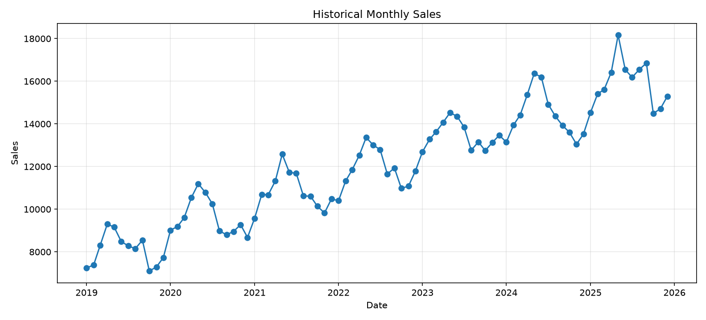
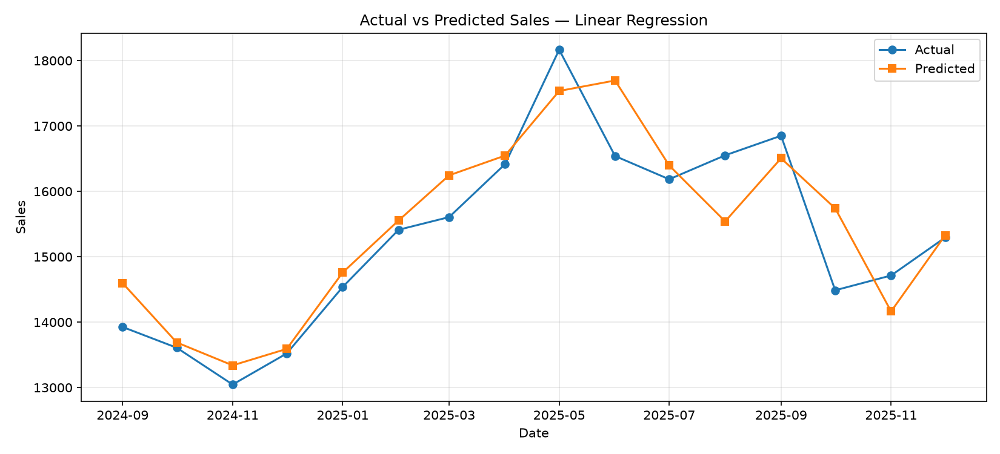
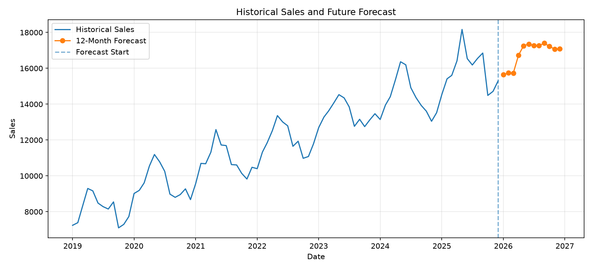

# Predictive Analytics Using Historical Data

[](https://www.python.org/)
[](https://scikit-learn.org/)
[](https://pandas.pydata.org/)
[]()

> **Assignment:** Predictive Analytics Using Historical Data  
> **Repository:** [assignment-2-Predictive-Analytics-Using-Historical-Data](https://github.com/Gannu2006/assignment-2-Predictive-Analytics-Using-Historical-Data.git)

---

## 1. Project Overview

This project provides an end-to-end predictive analytics and machine learning solution for forecasting monthly sales using historical business records. The pipeline cleans and preprocesses raw historical data, generates temporal and autoregressive features, trains and benchmarks multiple regression models (**Linear Regression** vs. **Random Forest Regressor**), rigorously evaluates them using statistical metrics, and produces an iterative 12-month future sales forecast.

---

## 2. Key Objectives & Deliverables

- **Data Preprocessing & Quality:** Inspect schema, detect missing values, and apply mean imputation to maintain chronological integrity.
- **Exploratory Data Analysis (EDA):** Analyze historical sales trends, growth patterns, and annual seasonal cycles.
- **Feature Engineering:** Construct calendar features (`Month`, `Year`), autoregressive lags (`Lag_1`, `Lag_3`, `Lag_6`), and rolling window metrics (`Rolling_Mean_3`).
- **Model Training & Comparison:** Compare Linear Regression against an ensemble Random Forest Regressor using chronological train/test splitting (80% train, 20% holdout test).
- **Model Evaluation:** Assess performance using Mean Absolute Error (MAE), Root Mean Squared Error (RMSE), and the Coefficient of Determination ($R^2$).
- **Multi-Step 12-Month Forecasting:** Project future monthly sales recursively for 2026 based on dynamic lag feeding.

---

## 3. Project Directory Structure

```text
assignment-2-Predictive-Analytics-Using-Historical-Data/
├── .gitignore                                 # Git ignore patterns
├── README.md                                  # Complete project documentation and report
├── requirements.txt                           # Python dependencies
├── historical_sales.csv                       # Historical monthly sales dataset (2019-2025)
├── main.py                                    # Automated end-to-end execution script
├── predictive_analytics_walkthrough.ipynb     # Interactive Jupyter Notebook with rich analysis & charts
└── outputs/                                   # Generated figures and forecast tables
    ├── historical_sales.png                   # Historical monthly sales trend visualization
    ├── actual_vs_predicted.png                # Holdout test set actual vs. predicted comparison
    ├── 12_month_forecast.png                  # Historical series + 12-month future forecast
    ├── model_metrics.csv                      # Comparative evaluation metrics
    └── next_12_month_forecast.csv             # Projected sales for next 12 months (2026)
```

---

## 4. Methodology & Implementation

### 4.1 Data Cleaning & Preprocessing
The dataset contains 84 monthly records spanning from January 2019 to December 2025. Sparse missing values identified in numeric columns (`Advertising_Spend`, `Product_Price`, and `Promotion`) were imputed with column-level means. Imputing with column averages preserves the sample size without introducing time-series gaps.

### 4.2 Feature Engineering
To capture temporal dynamics within tabular regression frameworks, several features were engineered:
- **Temporal Identifiers:** `Month` (seasonality indicator) and `Year` (secular trend tracker).
- **Autoregressive Lags:**
  - `Lag_1`: Immediate prior month sales (short-term momentum).
  - `Lag_3`: Sales 3 months prior (quarterly cycle).
  - `Lag_6`: Sales 6 months prior (half-year cycle).
- **Rolling Window Statistics:** `Rolling_Mean_3` (3-month moving average of past sales).

### 4.3 Chronological Splitting
Unlike cross-sectional problems, time-series data must not be randomly shuffled. A **strict chronological split** was applied:
- **Training Set (80%):** Earliest 62 observations (July 2019 – August 2024).
- **Testing Set (20%):** Latest 16 observations (September 2024 – December 2025).

---

## 5. Model Evaluation & Comparison

Both models were fitted on the training partition and evaluated strictly against the holdout test partition:

| Model | MAE ($) | RMSE ($) | $R^2$ Score | Selection |
| :--- | :---: | :---: | :---: | :---: |
| **Linear Regression** | **464.84** | **603.82** | **0.808** | **Selected (Best)** |
| **Random Forest Regressor** | 730.10 | 979.06 | 0.496 | Baseline |

### Evaluation Insights
- **Linear Regression** demonstrated superior generalization with an $R^2$ of **0.808** and an RMSE of **\$603.82** (38% lower error than Random Forest).
- **Why did Linear Regression outperform Random Forest?** Decision tree ensembles cannot extrapolate values outside the minimum and maximum ranges observed during training. Because the business has experienced sustained upward growth, tree-based models fail to predict values above the training ceiling, whereas Linear Regression effectively projects the growth slope.

---

## 6. Visualizations

### 6.1 Historical Sales Trend
The historical series illustrates clear secular revenue expansion along with recurring seasonal peaks.



### 6.2 Test Set: Actual vs. Predicted
The selected model accurately tracks the trajectory and seasonal turns across the holdout validation period.



### 6.3 12-Month Future Forecast
Combining the historical observations with the 12-month iterative forecast demonstrates the continuous growth trajectory into 2026.



---

## 7. 12-Month Sales Forecast (2026)

Using the selected Linear Regression model with dynamic recursive lag updating:

| Month | Date | Projected Sales ($) |
| :---: | :---: | :---: |
| 1 | 2026-01-01 | **$15,640.23** |
| 2 | 2026-02-01 | **$15,740.92** |
| 3 | 2026-03-01 | **$15,727.03** |
| 4 | 2026-04-01 | **$16,724.83** |
| 5 | 2026-05-01 | **$17,254.37** |
| 6 | 2026-06-01 | **$17,358.27** |
| 7 | 2026-07-01 | **$17,270.85** |
| 8 | 2026-08-01 | **$17,264.15** |
| 9 | 2026-09-01 | **$17,399.90** |
| 10 | 2026-10-01 | **$17,230.29** |
| 11 | 2026-11-01 | **$17,072.87** |
| 12 | 2026-12-01 | **$17,092.04** |

---

## 8. Business Takeaways & Recommendations

1. **Revenue Growth:** Total annual projected sales for 2026 are estimated at **\$203,775**, representing continuous ~8.5% year-over-year revenue growth.
2. **Seasonal Peak Planning:** Peak sales volumes occur between **May and September (exceeding \$17,200/month)**. Procurement and logistics teams should build inventory buffers starting in March/April.
3. **Model Maintenance:** Re-train the model quarterly as real 2026 monthly actuals arrive to adapt to market shifts or changing elasticity.

---

## 9. How to Run

### Option A: Command Line
```bash
# Clone the repository
git clone https://github.com/Gannu2006/assignment-2-Predictive-Analytics-Using-Historical-Data.git
cd assignment-2-Predictive-Analytics-Using-Historical-Data

# Install dependencies
pip install -r requirements.txt

# Execute the pipeline
python main.py
```

### Option B: Interactive Jupyter Notebook
Open and run `predictive_analytics_walkthrough.ipynb` in VS Code or Jupyter Lab to step through each phase interactively with code outputs and charts.
